# Basic Notes

Local-only floating notes for macOS, Raycast Notes-style: one panel, one note, plain `.md` files on disk. See [SPEC.md](SPEC.md).

## Install

```sh
scripts/package.sh          # Release build → build/dist/BasicNotes.zip
```

Unzip into `/Applications` and open it. Builds aren't notarized yet, so macOS blocks the first launch: System Settings → Privacy & Security → Open Anyway (or `xattr -dr com.apple.quarantine /Applications/BasicNotes.app`). Building it yourself skips that. It lives in the menu bar (no Dock icon), opens at login by default, and keeps notes in `~/Notes` (change it in Settings).

Building needs Xcode, `xcodegen`, `bun`, and network for the first `scripts/fetch-model.sh` (the bundled e5-small-v2 search model, ~130 MB).

## Use

- Toggle: `⌃⌥N` · new note: `⌃⌥⇧N` (both re-bindable in Settings), or the menu-bar icon
- Raycast: extension in [raycast/](raycast/README.md) (Toggle / New / Search / Open Note commands, bind Hyper+`\` to Toggle)
- In the panel: `⌘K` actions · `⌘P` search · `⌘N` new · `⌘[` / `⌘]` back/forward · `⌘⇧P` pin · `⌘1`–`⌘0` pins · `⌘⇧C` copy note · `⌘⇧⌫` delete to Trash · `⌘⇧K` link · `⌘=` / `⌘-` zoom · `Esc` / `⌘W` hide · `⌘,` settings
- Vim mode is opt-in in Settings (notes open in Normal; Esc in Normal hides)
- Opening a search match jumps to the passage and briefly highlights it. Opening a recent note restores your place.
- Panel opens 300×700; drag the header to move, any edge to resize (position, size and zoom are remembered)

## Notes

- `⌘⇧C` copies the whole note: Markdown with images inlined as data URIs and HTML with embedded images (Docs/Notion take these). A note with images also gets one PNG of the whole rendered note (640pt wide, 2×, scaled down past 10000px tall), so chat apps that paste only an image get all of it; if that render fails, each image goes on as its own item instead. No file URLs (WebKit/Safari would drop the text).
- Pasted/dropped images go to `<notes folder>/assets/` and are linked relatively. Right-click an image to copy it or remove it from the note (⌘Z restores it).
- Edited in two places at once? Both versions are kept: the other one becomes `<note-id>-conflict-<HHmmss>.md` next to the original.
- If a save fails at quit (notes folder gone/unwritable), the text is kept in a recovery folder and comes back as `<note-id>-recovered-….md` on next launch.
- App state (pins, history, search index) lives in `~/Library/Application Support/BasicNotes/`; delete it any time — it rebuilds from the `.md` files.

## Development

- `scripts/build.sh [Debug|Release]` — web bundle + app
- `scripts/run-test-app.sh` + `scripts/nbm` — isolated instance driven over a local automation API ([docs/automation.md](docs/automation.md))
- `scripts/eval.sh` — search quality/latency eval over `tools/fixtures`
- `web/` — CodeMirror 6 editor (`bun run dev` for the browser mock)

## License

[MIT](LICENSE)
